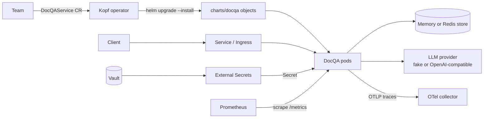

# DocQA: an AI document Q&A service, packaged and operated on Kubernetes

DocQA is a small FastAPI service that answers questions about a submitted document. It retrieves relevant chunks
and asks an LLM to answer strictly from them. Most of this repository is about **hosting and operating** that
workload: a hardened container, a Helm chart with per-environment values, secrets from Vault via External Secrets, a
`DocQAService` custom resource reconciled by a Kopf operator, Prometheus metrics, structured logs, OpenTelemetry
traces, SLO burn-rate alerts with runbooks, and a CI pipeline that validates, tests, builds and secures all of it.



## Quick start

No API key is needed: the default provider is a deterministic, extractive fake LLM.

```bash
make venv test lint     # 34 service + 3 operator tests, ruff, mypy
make run                # API on http://localhost:8080
BASE_URL=http://localhost:8080 scripts/smoke.sh
```

On a local kind cluster (Docker, kind, kubectl and Helm required):

```bash
make cluster platform build deploy smoke   # kind + Prometheus + External Secrets + Vault, then DocQA
make operator example                      # CRD, operator and two example DocQAService resources
make demo                                  # guided walkthrough (AUTO=1 for unattended)
```

[GUIDE.md](GUIDE.md) has the full walkthrough, timings and troubleshooting.

## API

| Method and path | Purpose | Success |
|---|---|---|
| `POST /v1/documents` `{"text": "..."}` | Submit a document (max `DOCQA_MAX_DOCUMENT_BYTES` UTF-8 bytes, default 100 000) | 201 `{document_id, chunks, size_bytes}` |
| `POST /v1/documents/{id}/questions` `{"question": "..."}` | Ask a question (max `DOCQA_MAX_QUESTION_CHARS`, default 1 000) | 200 `{answer, answerable, sources[], model}` |
| `GET /healthz` | Liveness | 200 |
| `GET /readyz` | Readiness: the document store is reachable. LLM health is deliberately ignored. | 200 or 503 |
| `GET /metrics` | Prometheus metrics | 200 |

Every error uses one envelope, and every response carries `x-request-id`:

```json
{"error": {"code": "llm_timeout", "message": "...", "request_id": "..."}}
```

| Status | Codes |
|---|---|
| 404 | `not_found` |
| 413 | `payload_too_large`. The exact limit applies to the decoded UTF-8 text. Bodies over 6× the limit (worst-case JSON escaping) are rejected from `Content-Length` before they are read. |
| 422 | `invalid_request` (the message never echoes the input) |
| 502 | `llm_error` |
| 503 | `llm_unavailable`, `llm_rate_limited`, `llm_circuit_open`, `llm_overloaded`, with `Retry-After` |
| 504 | `llm_timeout` |
| 500 | `internal_error` |

**Grounding.** The service refuses rather than inventing an answer at two points:

1. If no chunk reaches `DOCQA_MIN_RELEVANCE`, it answers "I can't answer that from the provided document."
   without calling the LLM. This is cheaper and can't hallucinate.
2. Otherwise the system prompt tells the model to answer only from the numbered context, or reply `NOT_FOUND`,
   which the service turns into the same refusal with `answerable: false`.

## Design notes by requirement

### 1. AI workload

- Retrieval is TF-IDF cosine similarity over overlapping word windows. It is deterministic, dependency-free and
  explainable. `retrieve()` is the seam where embeddings and a vector store would go.
- Providers implement one protocol: `FakeLLM` (no key, with latency and failure injection) and
  `OpenAICompatibleLLM` (OpenAI, Azure OpenAI or Ollama via `DOCQA_LLM_BASE_URL`). All configuration is a
  `DOCQA_*` environment variable. The API key is a `SecretStr` and is never logged.
- Documents are stored in an in-memory LRU with a TTL, or in Redis when there is more than one replica.

### 2. Packaging and deployment

- **Image:** multi-stage build on `python:3.11-slim`, non-root (UID 10001), no build tools in the runtime image, one
  uvicorn worker per pod (scale with replicas), and graceful shutdown. An optional corporate CA is passed as a
  BuildKit secret, so it never lands in a layer.
- **Chart:** restricted pod security (non-root, read-only root filesystem, all capabilities dropped,
  `RuntimeDefault` seccomp, no service account token). It also sets startup, liveness and readiness probes, a
  `preStop` sleep, `maxUnavailable: 0` rollouts, a config checksum that rolls pods, a default-deny NetworkPolicy,
  and an optional HPA, PDB, topology spread and Ingress.
- **Environments:** `values-dev.yaml` and `values-prod.yaml` change behaviour without touching templates. Prod uses a
  real LLM, Redis, autoscaling from 3 to 10 replicas, a PDB, an Ingress body limit and `DOCQA_TRACE_CONTENT=false`.
- **Secrets:** an `ExternalSecret` maps Vault paths to the env vars the app reads. The chart and the repo only
  contain *paths*, never values.

### 3. Custom resource

`DocQAService` (`platform.example.com/v1alpha1`) exposes what a team cares about: team, environment, size, replica
range, LLM provider, model and credentials *path*, document limits, SLO targets and ingress host. The OpenAPI schema
has bounds and enums, and CEL rules reject a real provider without credentials, the fake LLM in prod, and
`replicas.max < replicas.min`.

The Kopf operator follows the Helm-operator pattern. `spec_to_values()` is a pure, unit-tested mapping, and the
controller runs `helm upgrade --install` with the environment's baseline values plus the mapped values. It patches
status (phase, revision, endpoint, conditions) and re-installs the release if its Deployment disappears. **Trade-off:**
the chart stays the single source of truth for manifests, but the operator needs broad RBAC (Helm stores releases
in Secrets) and the objects have no ownerReferences to the CR.

### 4. Reliability and observability

- **Metrics:** request counts and latency by route template, LLM calls by outcome, LLM latency, tokens, estimated
  USD cost, in-flight calls, circuit state, answerable ratio and document sizes. Metric names are contracts that
  the alerts depend on.
- **Logs:** JSON from structlog, with `request_id`, `trace_id` and `span_id` on every line. A redaction processor
  is a safety net that replaces content and secret fields with `[REDACTED]`.
- **Tracing:** OpenTelemetry spans per request, retrieval and LLM call, with `gen_ai.*` token attributes, retry
  events and, when `trace_content` is on, the prompt and completion. Spans are exported over OTLP; there is never a
  console exporter.
- **SLOs:** 99.5% availability (non-5xx) and 95% of questions within 2.5 s. They are alerted with multi-window,
  multi-burn-rate rules: fast and medium burns page, the slow burn opens a ticket. There are four LLM and
  observability alerts in addition. Every alert links to a runbook in [docs/runbooks](docs/runbooks).
- **Resilience:** per-attempt timeouts, bounded retries with full-jitter backoff (retryable errors only), load
  shedding at a concurrency cap instead of queueing, and a circuit breaker tripped only by provider-health failures.
  Each failure has its own status code, error code, `Retry-After` and metric outcome. Readiness ignores the LLM, so
  an LLM outage degrades answers but doesn't empty the Service of endpoints.

### 5. Quality and delivery

Tests cover input validation, the mocked-LLM path, refusal, the keyless fake path, metrics, log hygiene, timeouts,
retries, the circuit breaker and OpenAI error mapping. CI runs ruff, mypy, pytest with an 80% coverage gate,
pip-audit, `helm lint`, kubeconform, promtool, and server-side dry runs of the CRD and CEL rules on kind. It also
runs gitleaks and Trivy config and image scans, then builds images with an SBOM. On `main` it cosign-signs and
attests the images and pushes the chart to an OCI registry.

## What I'd do next

1. Embeddings, a vector store and an evaluation set to measure answer quality and groundedness.
2. Authentication, plus per-team rate limits and token budgets.
3. Argo CD, and Argo Rollouts canaries gated on the SLO recording rules.
4. Operator v2: server-side apply with owner references, narrower RBAC and a validating webhook.
5. Grafana/Sloth dashboards, image digest pinning and locked dependencies.
